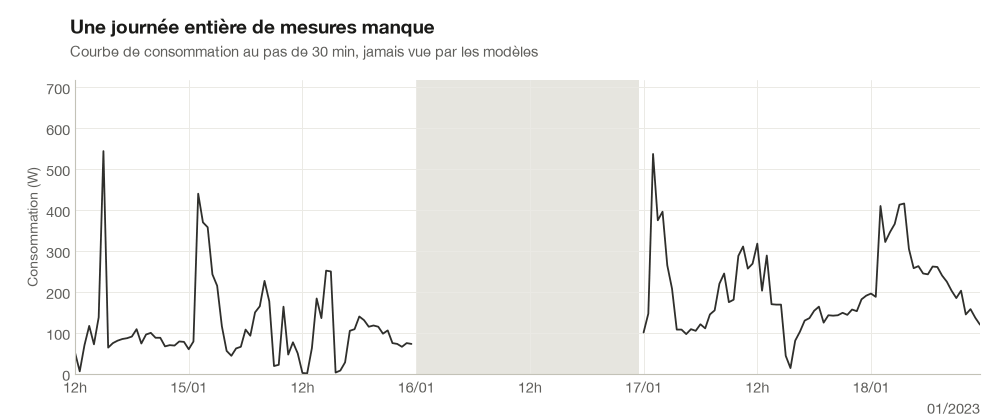
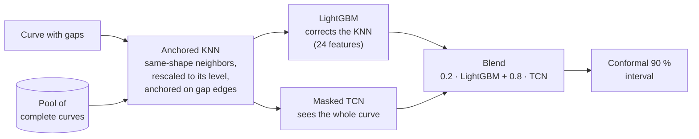
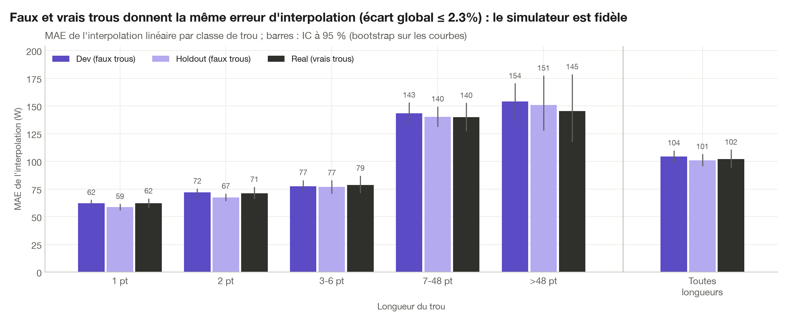
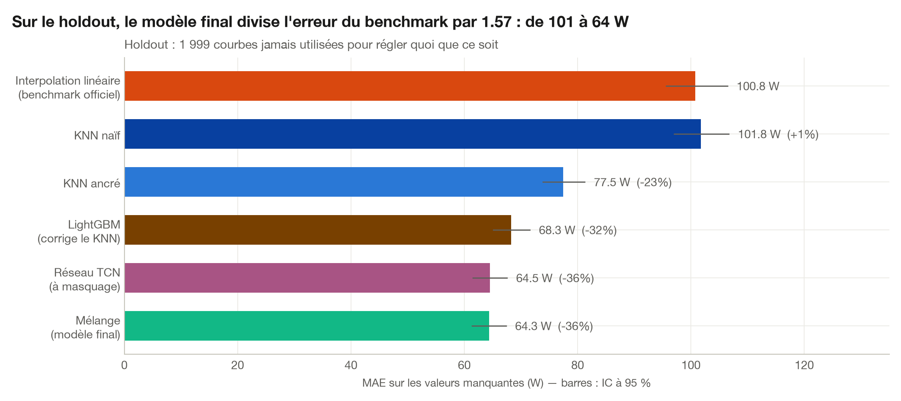

[Version française](README.md)

# Filling the gaps in electricity consumption curves

Imputing missing values in 30-minute load curves, from linear interpolation to a blend of LightGBM and a masked convolutional network, with calibrated confidence intervals.

| **−35 %** | **Top 7 %** | **90.1 %** |
|:---:|:---:|:---:|
| error vs the benchmark (public test set) | 12th out of 172 on the public leaderboard | coverage of intervals announced at 90 % |

**TL;DR.** Smart meters record consumption every 30 minutes, but some readings get lost. I built a model that reconstructs these missing values from the curve itself and from customers with similar behavior. On the challenge test set, it cuts the reference method's error by a third and ranks 12th out of 172 participants. For a grid operator, this means more reliable curves for energy balances and load forecasting, with a quantified uncertainty for every reconstructed value.

<i>A missing day: interpolation draws a straight line, the final model rebuilds the daily shape with its 90 % interval.</i>

## Results

- **Public test set: 104.54 W → 68.17 W** MAE on missing values (−35 %), **12th out of 172** on the public leaderboard (November 6, 2026).
- **Holdout**: 1,999 curves set aside at the start of the project and evaluated once, at the end (MAE in W, by gap length in 30-min steps).

| Method | 1 pt | 2 pts | 3-6 pts | 7-48 pts | > 48 pts | **All** | Paired gain vs benchmark |
|---|---|---|---|---|---|---|---|
| Linear interpolation (benchmark) | 58.6 | 67.5 | 76.8 | 140.1 | 150.8 | **100.80** | |
| Naive KNN (median of 5 neighbors) | 100.1 | 101.7 | 103.3 | 103.4 | 100.5 | **101.78** | +1.0 W, not significant |
| Anchored KNN | 57.7 | 66.4 | 74.6 | 94.9 | 94.6 | **77.46** | −23.3 W (−23 %) |
| LightGBM correcting the anchored KNN | 52.9 | 59.4 | 67.7 | 81.3 | 83.8 | **68.28** | −32.5 W (−32 %) |
| Masked TCN network | 48.4 | 55.6 | 63.5 | 78.0 | 81.0 | **64.53** | −36.3 W (−36 %) |
| **Blend 0.2 · LightGBM + 0.8 · TCN** | **48.3** | **55.4** | **63.3** | **77.7** | **80.6** | **64.35** | **−36.5 W [−39.9; −33.5] (−36 %)** |

Paired gains: bootstrap over curves, 95 % CI.

## Pipeline

Every decision was made on a `dev` set of simulated gaps (real gap patterns grafted onto complete curves), checked on the real gaps of the training set, and the final score was measured once on a `holdout`.

<i>Simulated and real gaps give the same interpolation error, class by class: the validation protocol is faithful.</i>

<i>On the holdout, each step brings a significant gain, from the benchmark to the final model.</i>

## Reproduce

1. Environment (Python 3.12, [uv](https://github.com/astral-sh/uv)): `uv sync`
2. Data: create an account on [challengedata.ens.fr](https://challengedata.ens.fr/challenges/160), join challenge #160 and download `X_train.csv`, `y_train.csv`, `X_test.csv` and `sample_submission.csv` into `data/raw/`.
3. Run the notebooks in order, 01 to 06 (`uv run jupyter lab`).
4. Demo: `uv run streamlit run app/streamlit_app.py`
5. Tests: `uv run pytest`

The code is released under the [MIT license](LICENSE). The data belongs to the challenge organizers and is not redistributed here.
