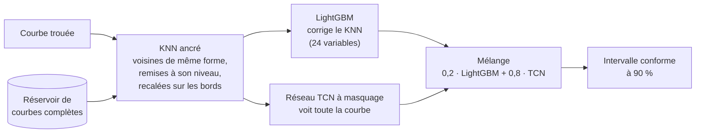

# Reconstruire les trous des courbes de consommation électrique

Imputer les valeurs manquantes de courbes de charge au pas de 30 minutes : de l'interpolation linéaire à un mélange LightGBM + réseau convolutif à masquage, avec des intervalles de confiance calibrés — **−35 % d'erreur par rapport au benchmark** sur le test du challenge.

[](https://www.python.org/)
[](https://github.com/astral-sh/uv)
[](https://github.com/astral-sh/ruff)
[](https://github.com/thibaudperes/ens-challenge-enedis-imputation/actions/workflows/ci.yml)


## Résultats en bref

- **Test public du challenge : 104,54 W → 68,17 W** de MAE sur les valeurs manquantes (−35 %), **12ᵉ sur 172** au classement public du 6 novembre 2026.
- **Holdout** : 1 999 courbes mises de côté dès le début du projet et évaluées une seule fois, à la fin (MAE en W, par longueur de trou en pas de 30 min) :

| Méthode | 1 pt | 2 pts | 3–6 pts | 7–48 pts | > 48 pts | **Toutes** | Gain apparié vs benchmark |
|---|---|---|---|---|---|---|---|
| Interpolation linéaire (benchmark) | 58,6 | 67,5 | 76,8 | 140,1 | 150,8 | **100,80** | — |
| KNN naïf (médiane de 5 voisines) | 100,1 | 101,7 | 103,3 | 103,4 | 100,5 | **101,78** | +1,0 W, non significatif |
| KNN ancré | 57,7 | 66,4 | 74,6 | 94,9 | 94,6 | **77,46** | −23,3 W (−23 %) |
| LightGBM qui corrige le KNN ancré | 52,9 | 59,4 | 67,7 | 81,3 | 83,8 | **68,28** | −32,5 W (−32 %) |
| Réseau TCN à masquage | 48,4 | 55,6 | 63,5 | 78,0 | 81,0 | **64,53** | −36,3 W (−36 %) |
| **Mélange 0,2 · LightGBM + 0,8 · TCN** | **48,3** | **55,4** | **63,3** | **77,7** | **80,6** | **64,35** | **−36,5 W [−39,9 ; −33,5] (−36 %)** |

Gains appariés : bootstrap sur les courbes, IC à 95 %. Les jeux `dev` (68,4 W) et `real` (66,8 W) donnent le même classement et les mêmes gains relatifs.


## Le problème

Les compteurs communicants mesurent la consommation de chaque client toutes les 30 minutes, mais des mesures manquent : pannes de communication, coupures, défauts de collecte. Pour la facturation, les bilans d'énergie ou la prévision de charge, il faut reconstruire ces trous de façon fiable. Ce projet répond au [Challenge Data ENS n°160](https://challengedata.ens.fr/challenges/160), « Comment remplir les valeurs manquantes de consommation électrique des clients ? », proposé par Enedis (groupe EDF), sur des courbes synthétiques : 20 000 courbes complètes et 1 000 courbes trouées en entraînement, 37 140 et 1 000 en test, du 9 au 31 janvier 2023 (1 057 pas de temps). La métrique est la MAE sur les seules valeurs manquantes.

## Le pipeline



Toutes les décisions sont prises sur un jeu `dev` de faux trous, vérifiées sur les vrais trous du train (`real`), et le score final est mesuré une seule fois sur un `holdout`.

## Démarche

### 1. Exploration : les trous suivent un calendrier

75 % des trous ne font qu'un point, mais les trous de 7 à 48 points, rares (4 %), portent 39 % des valeurs à prédire. Surtout, ils ne tombent pas au hasard : les blocs de 4 h commencent tous à 0 h, 4 h, 8 h… et les journées manquantes à minuit. Un simulateur de faux trous doit reproduire ces mécanismes, pas seulement la distribution des longueurs.


### 2. Un protocole de validation fiable : la greffe de masques

On greffe le motif exact de NaN d'une vraie courbe trouée sur une courbe complète, aux mêmes horodates : longueurs, calendrier et taux de trous sont reproduits à l'identique. La position des trous ne dépend pas des valeurs (corrélations ≤ 0,06 en valeur absolue ; valeurs cachées à +0,005 écart-type du comportement habituel de la courbe). Résultat : sur faux et vrais trous, l'interpolation fait la même erreur, à 2,3 % près. Trois jeux étanches (`dev`, `holdout`, `real`), une règle anti-fuite testée, un registre de tous les résultats.


### 3. KNN ancré : trois idées, −21 %

Le KNN naïf copie la forme des voisines à leur niveau à elles et ignore les points observés autour du trou. Trois corrections : **ancrer** la prédiction sur les bords du trou, **choisir les voisines sur leur forme** puis les **remettre au niveau** de la courbe (transformation affine), et **atténuer l'ancre** au milieu des longs trous. Distances L2 calculées par produits matriciels masqués : 3 s pour 2 000 courbes et 16 000 voisines.


### 4. LightGBM : corriger le KNN, et ne pas se fier au « gain »

Un LightGBM (objectif L1) apprend la correction à apporter au KNN ancré, sur 2 millions de faux trous greffés sur le réservoir, avec des prédictions KNN hors pli. Il gagne 9 W sur dev comme sur real. Piège d'interprétation : l'importance « gain » attribue 70 % à la distance aux voisines, qui ne déplace la prédiction que de 2 W ; les valeurs SHAP montrent que le modèle s'appuie en réalité sur la mémoire de la courbe (même créneau la veille et le lendemain).


### 5. Réseau à masquage et mélange

Un réseau convolutif à dilatations (TCN, 117 000 paramètres, 255 pas de champ réceptif) voit la courbe entière et prédit le résidu du KNN ancré, avec une perte L1 calculée uniquement sur les points masqués. Il bat le LightGBM de 4 W. Leur mélange ne gagne que 0,2 W de plus : leurs erreurs sont corrélées à 0,92. Le poids du mélange est choisi sur 1 000 courbes de calibration, jamais sur dev.


### 6. Intervalles de confiance conformes

Prédiction conforme calibrée par classe de longueur de trou : sur le holdout, l'intervalle à 90 % contient **90,1 %** des vraies valeurs, et chaque classe reste entre 88,7 % et 90,6 %. Largeur moyenne : ±145 W, le reflet honnête de la volatilité d'une courbe individuelle.


### 7. Biais et agrégats : la meilleure MAE n'est pas le meilleur bilan d'énergie

Entraîné en L1, le modèle vise la médiane : il sous-estime l'énergie manquante d'environ 4 %, quand l'interpolation est quasi non biaisée (−0,5 %). Sur une courbe agrégée de 2 000 clients, les erreurs individuelles se compensent et seul le biais reste : l'interpolation y fait jeu égal. Pour un bilan d'énergie, un décalage appris sur la calibration annule le biais (−3,8 % → −0,3 % sur dev) au prix de 3 W de MAE.


## Démo

Une appli Streamlit permet de choisir une courbe jamais vue à l'entraînement, de lui greffer un vrai motif de trous ou un trou personnalisé (jusqu'à 3 jours), et de comparer les reconstructions et leur erreur.


## Reproduire le projet

1. **Environnement** (Python 3.12, [uv](https://github.com/astral-sh/uv)) :
   ```bash
   uv sync
   ```
2. **Données** : créer un compte sur [challengedata.ens.fr](https://challengedata.ens.fr/challenges/160), s'inscrire au challenge n°160 et télécharger `X_train.csv`, `y_train.csv`, `X_test.csv` et `sample_submission.csv` dans `data/raw/`. Les données ne sont pas redistribuées dans ce dépôt.
3. **Notebooks**, dans l'ordre (`uv run jupyter lab`) — les calculs longs sont mis en cache dans `data/processed/` :

   | Notebook | Contenu | Durée indicative (MacBook Air M1) |
   |---|---|---|
   | `01_eda` | exploration | 2 min |
   | `02_validation` | jeux dev / holdout / real, simulateur | 3 min |
   | `03_knn` | KNN ancré | 10 min |
   | `04_lightgbm` | LightGBM, SHAP, MLflow | 40 min (grille), puis 2 min |
   | `05_deep_learning` | TCN et mélange | 25 min (entraînement), puis 5 min |
   | `06_incertitude_et_score_final` | intervalles, agrégats, holdout, soumission | 11 min |

4. **Démo** : `uv run streamlit run app/streamlit_app.py`
5. **Tests et qualité** : `uv run pytest` et `uv run ruff check .`
6. **Suivi des expériences** : `uv run mlflow ui --backend-store-uri sqlite:///mlruns/mlflow.db`

## Structure du dépôt

```
app/streamlit_app.py         démo interactive
notebooks/                   01 → 06, de l'exploration au score final
reports/figures/             figures et animations du README
reports/results.csv          registre de toutes les évaluations
scripts/                     visuels du README, enregistrement de la démo
src/enedis_imputation/
    data.py                  chargement (cache .npy), métrique
    holes.py                 description des trous
    validation.py            greffe de masques, jeux, évaluation, comparaisons appariées
    methods.py, knn.py       interpolation, KNN naïf, KNN ancré
    features.py, gbm.py      variables et LightGBM hors pli
    deep.py                  réseau à masquage, mélange
    uncertainty.py           intervalles conformes, biais
    submission.py            format de soumission
    viz.py                   style des figures, palette
tests/                       tests (anti-fuite, distances, métriques, format…)
```

## Limites et perspectives

- **Pistes conçues mais non testées**, faute de temps de calcul (~4 h estimées sur le portable utilisé) : donner au réseau les voisines elles-mêmes en canaux, l'entraîner aussi sur les courbes complètes du test, et l'entraîner sur plusieurs motifs par courbe avec une moyenne de graines. Les premières places du classement public (55,6 à 58,6 W) suggèrent qu'il reste une marge.
- **Biais de l'objectif L1** : −4 % d'énergie manquante. Un objectif qui vise la moyenne, ou une recalibration par classe de trou, servirait mieux les usages de bilan.
- **Transformer sur patchs abandonné** à mi-entraînement : 4 W derrière le TCN en validation, probablement parce que le découpage en patchs de 8 pas brouille les trous de 1–2 points.
- **Données synthétiques et période courte** (un mois d'hiver) : la généralisation à d'autres saisons reste à vérifier.

---

Toutes les figures utilisent une palette dont les couleurs restent distinguables sous les trois formes courantes de daltonisme (vérification par différence de couleur en espace OKLab).
