[English version](README.en.md)

# Reconstruire les trous des courbes de consommation électrique

Imputer les valeurs manquantes de courbes de charge au pas de 30 minutes, de l'interpolation linéaire à un mélange LightGBM + réseau convolutif à masquage, avec des intervalles de confiance calibrés.

| **−35 %** | **Top 7 %** | **90,1 %** |
|:---:|:---:|:---:|
| d'erreur par rapport au benchmark<br>(test public du challenge) | 12ᵉ sur 172<br>au classement public | de couverture pour des<br>intervalles annoncés à 90 % |

**En bref.** Les compteurs communicants mesurent la consommation toutes les 30 minutes, mais certaines mesures se perdent. J'ai construit un modèle qui reconstitue ces valeurs manquantes à partir de la courbe elle-même et de courbes de clients au comportement proche. Sur le jeu de test du challenge, il réduit d'un tiers l'erreur de la méthode de référence et se classe 12ᵉ sur 172 participants. Pour un gestionnaire de réseau, cela donne des courbes plus fiables pour les bilans d'énergie et la prévision de charge, avec une marge d'incertitude chiffrée pour chaque valeur reconstruite.

[](https://www.python.org/)
[](https://github.com/astral-sh/uv)
[](https://github.com/astral-sh/ruff)
[](https://github.com/thibaudperes/ENS-ENEDIS/actions/workflows/ci.yml)

<p align="center">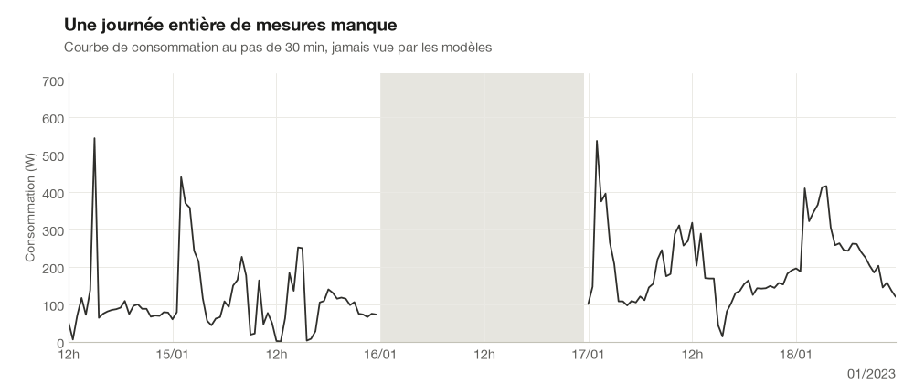</p>
<p align="center"><i>Une journée manquante : l'interpolation trace une droite, le modèle final reconstruit la forme avec son intervalle à 90 %.</i></p>

## Résultats en bref

- **Test public du challenge : 104,54 W → 68,17 W** de MAE sur les valeurs manquantes (−35 %), **12ᵉ sur 172** au classement public du 6 novembre 2026.
- **Holdout** : 1 999 courbes mises de côté dès le début du projet et évaluées une seule fois, à la fin (MAE en W, par longueur de trou en pas de 30 min).

| Méthode | 1 pt | 2 pts | 3-6 pts | 7-48 pts | > 48 pts | **Toutes** | Gain apparié vs benchmark |
|---|---|---|---|---|---|---|---|
| Interpolation linéaire (benchmark) | 58,6 | 67,5 | 76,8 | 140,1 | 150,8 | **100,80** | |
| KNN naïf (médiane de 5 voisines) | 100,1 | 101,7 | 103,3 | 103,4 | 100,5 | **101,78** | +1,0 W, non significatif |
| KNN ancré | 57,7 | 66,4 | 74,6 | 94,9 | 94,6 | **77,46** | −23,3 W (−23 %) |
| LightGBM qui corrige le KNN ancré | 52,9 | 59,4 | 67,7 | 81,3 | 83,8 | **68,28** | −32,5 W (−32 %) |
| Réseau TCN à masquage | 48,4 | 55,6 | 63,5 | 78,0 | 81,0 | **64,53** | −36,3 W (−36 %) |
| **Mélange 0,2 · LightGBM + 0,8 · TCN** | **48,3** | **55,4** | **63,3** | **77,7** | **80,6** | **64,35** | **−36,5 W [−39,9 ; −33,5] (−36 %)** |

Gains appariés : bootstrap sur les courbes, IC à 95 %. Les jeux `dev` (68,4 W) et `real` (66,8 W) donnent le même classement et les mêmes gains relatifs.

<p align="center">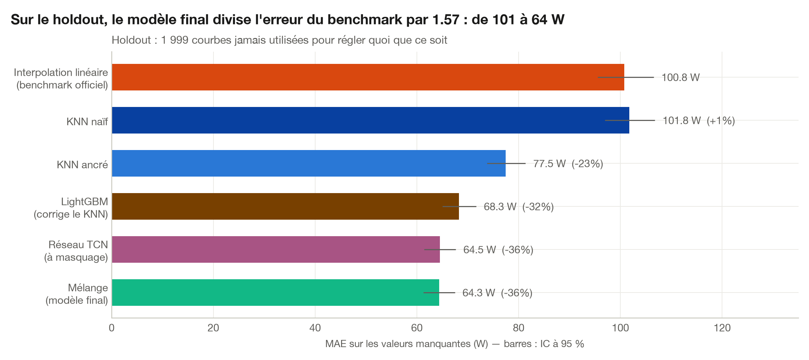</p>
<p align="center"><i>Sur le holdout, chaque étape apporte un gain significatif, du benchmark au modèle final.</i></p>

## Ce que ce projet démontre

| Compétence | Où la vérifier |
|---|---|
| Rigueur de validation : faux trous validés contre de vrais trous, règle anti-fuite testée, holdout utilisé une seule fois | [notebook 02](notebooks/02_validation.ipynb), [figure](reports/figures/v4_simulateur_fidele.png), [tests](tests/test_validation.py) |
| Séries temporelles et machine learning : KNN sur mesure, LightGBM entraîné hors pli, comparaisons appariées | [notebook 03](notebooks/03_knn.ipynb), [notebook 04](notebooks/04_lightgbm.ipynb) |
| Deep learning PyTorch : réseau convolutif à masquage, perte sur les seuls points masqués, entraînement sur GPU Apple | [notebook 05](notebooks/05_deep_learning.ipynb), [code](src/enedis_imputation/deep.py) |
| Quantification d'incertitude : prédiction conforme, couverture vérifiée par classe de trou | [notebook 06](notebooks/06_incertitude_et_score_final.ipynb), [figure](reports/figures/u1_couverture.png) |
| Sens métier énergie : calendrier des trous, biais sur les agrégats et bilans d'énergie | [notebook 01](notebooks/01_eda.ipynb), [figure](reports/figures/u3_courbe_agregee.png) |
| Ingénierie : package Python, 60 tests, CI, uv, ruff, suivi MLflow, démo Streamlit | [src](src/enedis_imputation), [tests](tests), [CI](.github/workflows/ci.yml), [appli](app/streamlit_app.py) |

## Le problème

Les compteurs communicants mesurent la consommation de chaque client toutes les 30 minutes, mais des mesures manquent : pannes de communication, coupures, défauts de collecte. Pour la facturation, les bilans d'énergie ou la prévision de charge, il faut reconstruire ces trous de façon fiable. Ce projet répond au [Challenge Data ENS n°160](https://challengedata.ens.fr/challenges/160), « Comment remplir les valeurs manquantes de consommation électrique des clients ? », proposé par Enedis (groupe EDF), sur des courbes synthétiques : 20 000 courbes complètes et 1 000 courbes trouées en entraînement, 37 140 et 1 000 en test, du 9 au 31 janvier 2023 (1 057 pas de temps). La métrique est la MAE sur les seules valeurs manquantes.

## Le pipeline

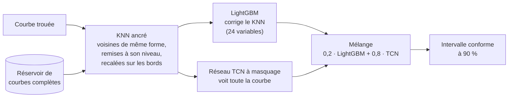

J'ai pris toutes les décisions sur un jeu `dev` de faux trous, je les ai vérifiées sur les vrais trous du train (`real`), et j'ai mesuré le score final une seule fois sur un `holdout`.

## Démarche

### 1. Exploration : les trous suivent un calendrier

En comptant les trous, j'ai d'abord vu que 75 % ne font qu'un point. En comptant les valeurs à prédire, la conclusion change : les trous de 7 à 48 points, rares (4 %), en portent 39 %. Puis j'ai remarqué qu'ils ne tombent pas au hasard. Les blocs de 4 h commencent tous à 0 h, 4 h, 8 h…, et les journées manquantes à minuit. J'en ai conclu que mes faux trous devraient reproduire ces mécanismes, pas seulement la distribution des longueurs.

<p align="center">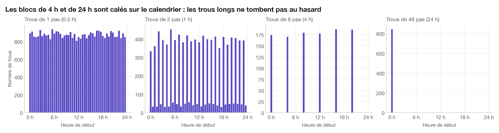</p>
<p align="center"><i>Les blocs de 4 h et de 24 h commencent à heure fixe : les trous longs ne tombent pas au hasard.</i></p>

### 2. Un protocole de validation fiable : la greffe de masques

Pour tester mes méthodes sur des valeurs dont je connais la vérité, je greffe le motif exact de NaN d'une vraie courbe trouée sur une courbe complète, aux mêmes horodates. Longueurs, calendrier et taux de trous sont ainsi reproduits à l'identique. J'ai d'abord vérifié que c'était légitime : la position des trous ne dépend pas des valeurs (corrélations ≤ 0,06 en valeur absolue ; valeurs cachées à +0,005 écart-type du comportement habituel de la courbe). Sur faux et vrais trous, l'interpolation fait la même erreur, à 2,3 % près. J'ai ensuite construit trois jeux étanches (`dev`, `holdout`, `real`), une règle anti-fuite vérifiée par des tests et un registre de tous les résultats.

<p align="center">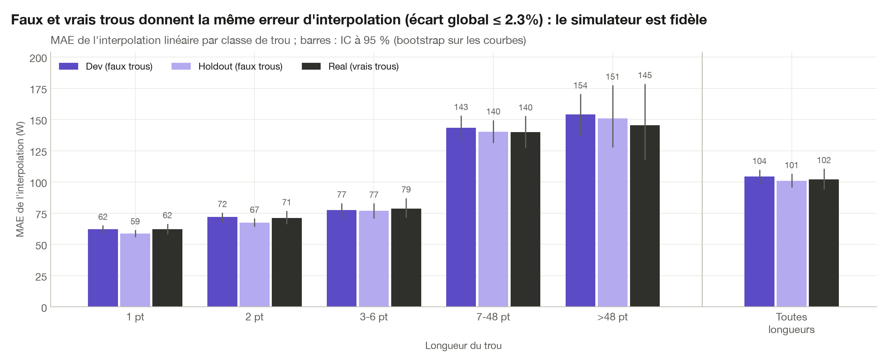</p>
<p align="center"><i>Faux et vrais trous donnent la même erreur d'interpolation, classe par classe : le simulateur est fidèle.</i></p>

### 3. KNN ancré : trois idées, −21 %

Le KNN naïf copie la forme des voisines à leur niveau à elles et ignore les points observés autour du trou. J'ai d'abord ancré la prédiction sur les bords du trou. Sur les trous courts, l'effet était net (de 105 à 65 W sur les trous d'un point), mais sur les trous de 7 à 48 points l'erreur montait de 107 à 126 W : le résidu mesuré sur un seul point du bord se propageait sur toute la journée. J'ai ensuite choisi les voisines sur leur forme et je les ai remises au niveau de la courbe (93 W), puis j'ai atténué l'ancre loin des bords, ce qui a ramené l'erreur à 83 W. Au total, le KNN ancré bat l'interpolation de 21 % sur dev. Les distances sont calculées par produits matriciels masqués : 3 s pour 2 000 courbes et 16 000 voisines.

<p align="center">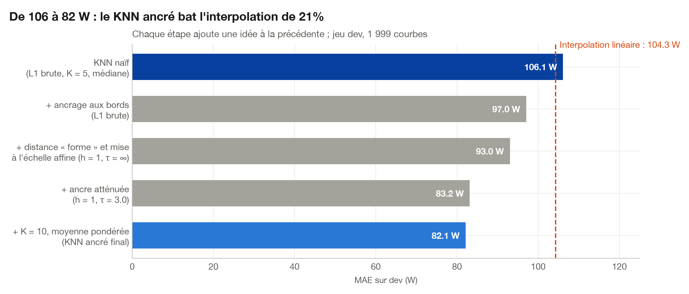</p>
<p align="center"><i>Chaque idée s'ajoute à la précédente : de 106 à 82 W sur dev.</i></p>

### 4. LightGBM : corriger le KNN, et ne pas se fier au « gain »

J'ai ensuite entraîné un LightGBM (objectif L1) à prédire la correction à apporter au KNN ancré, sur 2 millions de faux trous greffés sur le réservoir. Pour que ses entrées ressemblent à celles qu'il verra en production, j'ai calculé les prédictions KNN hors pli : une courbe n'est jamais sa propre voisine. Il gagne 9 W sur dev comme sur real. En l'analysant, j'ai failli tirer une mauvaise conclusion : l'importance « gain » attribue 70 % à la distance aux voisines, qui ne déplace la prédiction que de 2 W. Les valeurs SHAP montrent que le modèle s'appuie en réalité sur la mémoire de la courbe, au même créneau la veille et le lendemain.

<p align="center">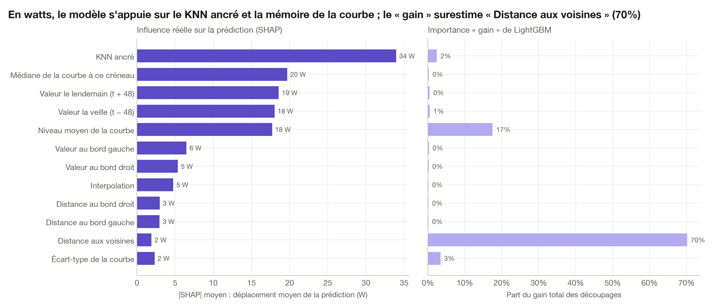</p>
<p align="center"><i>En watts (SHAP), le modèle s'appuie sur le KNN ancré et la mémoire de la courbe ; le « gain » trompe.</i></p>

<details>
<summary>Les 24 variables du LightGBM</summary>

- **Prédictions de base** : KNN ancré, KNN non ancré, interpolation linéaire.
- **Désaccord des voisines** : écart-type et écart interquartile des voisines mises à l'échelle à cet instant, distance moyenne aux voisines.
- **Position dans le trou** : longueur du trou, distances aux bords gauche et droit, position relative.
- **Calendrier** : heure (sinus et cosinus), jour de semaine, week-end.
- **Mémoire de la courbe** : valeurs observées la veille et le lendemain au même créneau, une semaine avant et après, médiane de la courbe à ce créneau.
- **Contexte** : valeurs observées aux bords du trou, niveau moyen, écart-type et part de zéros de la courbe.

Toutes ne dépendent que des points observés et du réservoir. Le code est dans [`features.py`](src/enedis_imputation/features.py).
</details>

### 5. Réseau à masquage et mélange

Un réseau voit la courbe entière, là où le LightGBM ne voit que des variables construites à la main. J'ai essayé deux architectures. Le transformer sur patchs de 8 pas restait 4 W derrière le TCN en validation (65,2 contre 61,1 W) à l'epoch 12 ; je l'ai abandonné. Le TCN, un réseau convolutif à dilatations, prédit le résidu du KNN ancré avec une perte L1 calculée uniquement sur les points masqués. Il bat le LightGBM de 4 W. Leur mélange ne gagne que 0,2 W de plus : leurs erreurs sont corrélées à 0,92. J'ai choisi le poids du mélange sur 1 000 courbes de calibration, jamais sur dev.

<p align="center">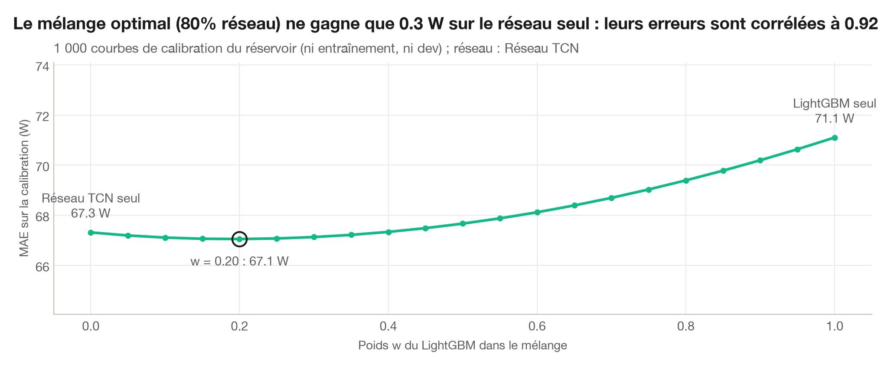</p>
<p align="center"><i>Le mélange optimal (80 % réseau) ne gagne que 0,3 W sur la calibration : les deux modèles se trompent aux mêmes endroits.</i></p>

<details>
<summary>Architecture et entraînement du TCN</summary>

- **Entrées** (8 canaux, normalisés par le niveau moyen observé de la courbe) : valeurs observées, masque, KNN ancré, interpolation, écart-type des voisines, heure (sinus, cosinus), week-end.
- **Réseau** : convolutions 1D dilatées (dilatations 1 à 64, noyau 3, 64 canaux), connexions résiduelles, GroupNorm ; 117 249 paramètres, champ réceptif de 255 pas (plus de 5 jours).
- **Sortie et perte** : le résidu y − KNN ancré ; L1 sur les points masqués, remise en watts.
- **Entraînement** : AdamW, lots de 32 courbes, arrêt anticipé sur 10 % des courbes du réservoir, 20 epochs de 70 s sur le GPU d'un MacBook Air M1 (23 min). Ma première boucle d'entraînement lisait la perte à chaque lot, ce qui forçait le processeur à attendre le GPU et triplait le temps par epoch ; en accumulant la perte sur le GPU, je suis revenu à 70 s.
</details>

### 6. Intervalles de confiance conformes

Pour qu'un utilisateur sache à quel point se fier à chaque valeur, j'ai calibré des intervalles par prédiction conforme, une marge par classe de longueur de trou. Sur le holdout, l'intervalle à 90 % contient **90,1 %** des vraies valeurs, et chaque classe reste entre 88,7 % et 90,6 %. J'ai aussi testé des intervalles adaptés à la difficulté de chaque point : ils couvraient aussi bien mais étaient plus larges. La largeur moyenne, ±145 W, reflète honnêtement la volatilité d'une courbe individuelle.

<p align="center">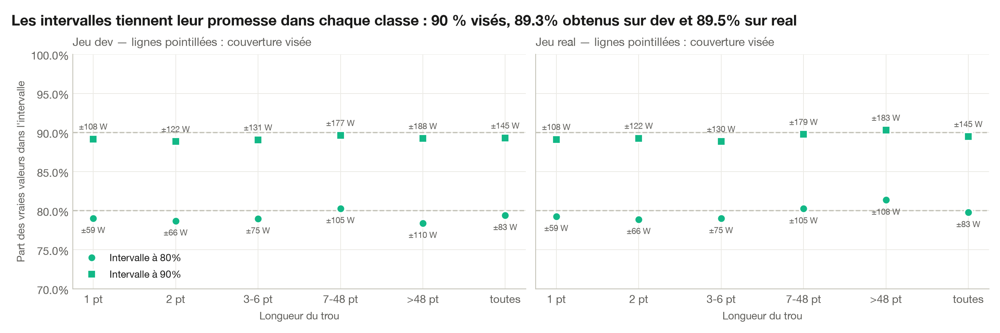</p>
<p align="center"><i>Couverture obtenue contre couverture visée, par classe de trou, sur dev et real.</i></p>

### 7. Biais et agrégats : la meilleure MAE n'est pas le meilleur bilan d'énergie

En regardant l'erreur signée, j'ai constaté que mon modèle sous-estime l'énergie manquante d'environ 4 % : entraîné en L1, il vise la médiane. L'interpolation, elle, est quasi non biaisée (−0,5 %). Sur une courbe agrégée de 2 000 clients, les erreurs individuelles se compensent et seul le biais reste : l'interpolation y fait jeu égal. Pour un bilan d'énergie, un décalage appris sur la calibration annule le biais (−3,8 % → −0,3 % sur dev) au prix de 3 W de MAE. Je ne l'ai pas appliqué à la soumission, jugée en MAE.

<p align="center">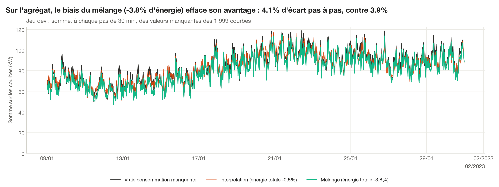</p>
<p align="center"><i>Sur l'agrégat, le biais du mélange efface son avantage sur l'interpolation.</i></p>

## Démo

L'appli Streamlit permet de choisir une courbe jamais vue à l'entraînement, de lui greffer un vrai motif de trous ou un trou personnalisé (jusqu'à 3 jours), et de comparer les reconstructions et leur erreur.

<p align="center">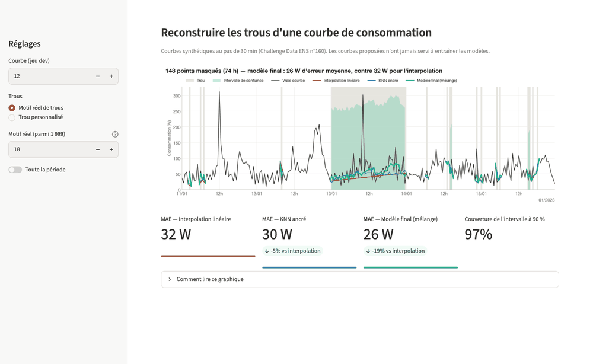</p>
<p align="center"><i>Trou personnalisé qui s'allonge de 12 h à 3 jours : erreur de chaque méthode et couverture de l'intervalle.</i></p>

## Reproduire le projet

1. **Environnement** (Python 3.12, [uv](https://github.com/astral-sh/uv)) :
   ```bash
   uv sync
   ```
2. **Données** : créer un compte sur [challengedata.ens.fr](https://challengedata.ens.fr/challenges/160), s'inscrire au challenge n°160 et télécharger `X_train.csv`, `y_train.csv`, `X_test.csv` et `sample_submission.csv` dans `data/raw/`.
3. **Notebooks**, dans l'ordre de 01 à 06 (`uv run jupyter lab`). Les calculs longs sont mis en cache dans `data/processed/`.
4. **Démo** : `uv run streamlit run app/streamlit_app.py`
5. **Tests et qualité** : `uv run pytest` et `uv run ruff check .`
6. **Suivi des expériences** : `uv run mlflow ui --backend-store-uri sqlite:///mlruns/mlflow.db`

<details>
<summary>Durée des notebooks (MacBook Air M1, 8 Go)</summary>

| Notebook | Contenu | Durée indicative |
|---|---|---|
| `01_eda` | exploration | 2 min |
| `02_validation` | jeux dev / holdout / real, simulateur | 3 min |
| `03_knn` | KNN ancré | 10 min |
| `04_lightgbm` | LightGBM, SHAP, MLflow | 40 min (grille), puis 2 min |
| `05_deep_learning` | TCN et mélange | 25 min (entraînement), puis 5 min |
| `06_incertitude_et_score_final` | intervalles, agrégats, holdout, soumission | 11 min |
</details>

## Structure du dépôt

```
app/streamlit_app.py         démo interactive
notebooks/                   01 à 06, de l'exploration au score final
reports/figures/             figures et animations du README
reports/results.csv          registre de toutes les évaluations
scripts/                     visuels du README, enregistrement de la démo
src/enedis_imputation/
    data.py                  chargement (cache .npy), métrique
    holes.py                 description des trous
    validation.py            greffe de masques, jeux, évaluation, comparaisons appariées
    methods.py, knn.py       interpolation, KNN naïf, KNN ancré
    features.py, gbm.py      variables et LightGBM hors pli
    deep.py                  réseau à masquage, mélange
    uncertainty.py           intervalles conformes, biais
    submission.py            format de soumission
    viz.py                   style des figures, palette
tests/                       tests (anti-fuite, distances, métriques, format…)
```

## Limites et perspectives

- **Des pistes que je n'ai pas pu tester.** J'avais conçu trois améliorations du réseau : lui donner les voisines elles-mêmes en canaux, l'entraîner aussi sur les courbes complètes du test, et l'entraîner sur plusieurs motifs par courbe avec une moyenne de graines. Leur entraînement était estimé à environ 4 h sur mon portable ; je me suis arrêté là. Les premières places du classement public (55,6 à 58,6 W) suggèrent qu'il reste une marge.
- **Le biais de l'objectif L1** : −4 % d'énergie manquante. Un objectif qui vise la moyenne, ou une recalibration par classe de trou, servirait mieux les usages de bilan.
- **Le transformer abandonné** : 4 W derrière le TCN en validation au moment où je l'ai arrêté. Je pense que le découpage en patchs de 8 pas brouille les trous de 1 ou 2 points, qui portent la moitié des valeurs à prédire.
- **Des données synthétiques sur un mois d'hiver** : la généralisation à d'autres saisons reste à vérifier.

## Licence et données

Le code est publié sous [licence MIT](LICENSE). Les données appartiennent aux organisateurs du challenge et ne sont pas redistribuées dans ce dépôt.

Toutes les figures utilisent une palette dont les couleurs restent distinguables sous les trois formes courantes de daltonisme (vérification par différence de couleur en espace OKLab).
